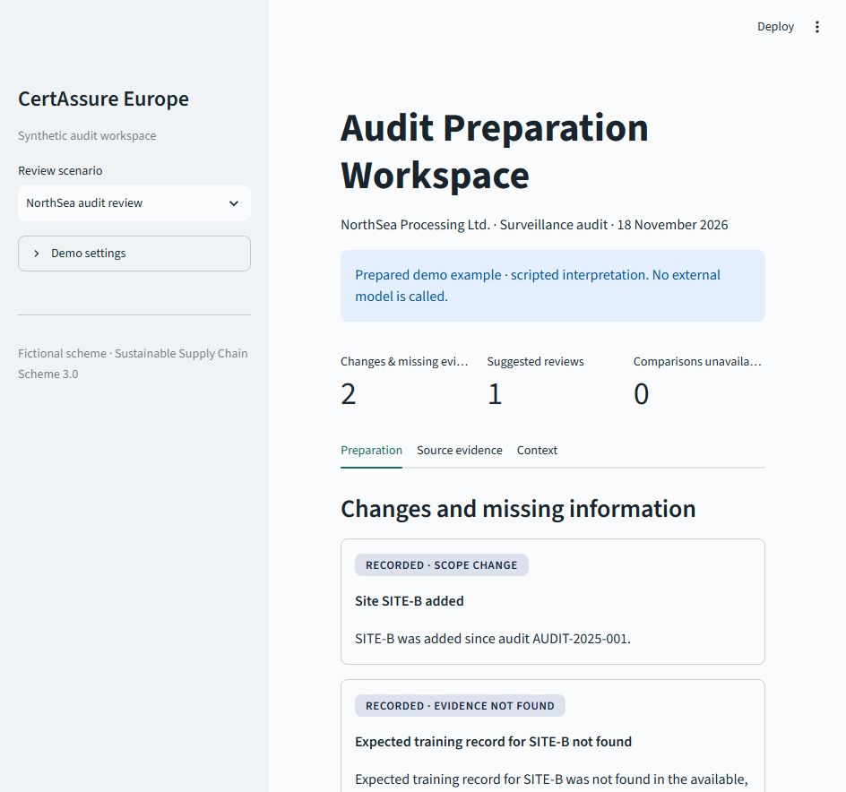
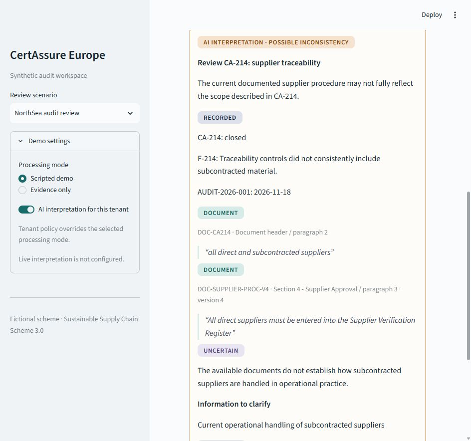

# Audit Preparation Challenge

An evidence-backed workspace that helps an auditor prepare for a forthcoming audit.
Exact rules show scope changes and missing evidence. An optional, constrained interpretation
compares a closed corrective action with the current documented procedure. The auditor decides
what to investigate; the application never creates findings or changes recorded statuses.

All organizations, documents, and the **Sustainable Supply Chain Scheme 3.0** are synthetic.
The default interpretation is scripted. It demonstrates the workflow and validation contracts,
not model reasoning, real-world accuracy, or preparation-time savings.

## Run

Python 3.14 and uv are required. From the repository root:

```powershell
uv sync --all-extras --frozen
uv run streamlit run src/audit_prep/demo.py
```

Open [the local workspace](http://127.0.0.1:8501). Offline mode needs no credentials.
The server binds to loopback and Streamlit usage telemetry is disabled.

The workspace opens directly into a prepared demo example, with scripted interpretation clearly
labelled. Selecting a scenario loads its example without a preparation button. Examples are computed
locally when selected; this prototype does not run a background preparation worker.

The six walkthrough scenarios cover a possible inconsistency, missing procedure, matching
documents, conflicting sources, foreign-tenant exclusion, and provider failure. The tenant AI
switch and evidence-only mode preserve deterministic signals and available source evidence. These
controls are under **Demo settings**. **Live Azure** is hidden unless all three required Azure
environment variables are nonempty.





The CLI uses the same service:

```powershell
uv run audit-prep
uv run audit-prep --provider disabled
uv run audit-prep --scenario matching
uv run audit-prep --json --output eval/reports/northsea.json
```

## The smallest useful question

The hypothesis is that concrete, traceable preparation items reduce the effort of reconstructing
context. This slice asks: **is the current documented procedure consistent with a previously
recorded corrective-action commitment?**

In the NorthSea case:

| Input | Preparation behavior |
| --- | --- |
| SITE-B was added since the previous audit | Exact scope-change signal |
| A SITE-B training record is expected but not found | Missing-evidence signal, not a claim that personnel were untrained |
| CA-214 is closed and its document includes subcontracted suppliers | Preserve the recorded status and commitment |
| Procedure v4 explicitly covers direct suppliers | Tentative comparison with the commitment |

The suggested follow-up is to verify how subcontracted suppliers are handled. Documentary wording
does not establish operational practice. The workspace separates **Recorded**, **Document**,
**AI interpretation**, **Uncertain**, and **Follow-up** statements.

## Design and boundaries

```text
Authorized records and documents
    -> deterministic signals and one constrained comparison candidate
    -> dated source selection and local TF-IDF retrieval
    -> optional structured interpretation
    -> reference, quote, and output validation
    -> preparation result with sources, abstentions, and an input fingerprint
```

CLI, Streamlit, and evaluation share `AuditPreparationService`. Pydantic defines the contracts;
the provider sits behind `InterpretationModel`. The flow is synchronous and fixed. Documents are
filtered before ranking and model context construction. Invalid output, incomplete evidence,
unreliable extraction, and provider failure reduce assistance while preserving deterministic work.

The scope is deliberately one supplier-traceability comparison. There is no OCR, real scheme
rulebook, autonomous agent, vector database, production authentication, or audit-state mutation.
Caller-supplied authorization is a prototype boundary. Quote integrity does not prove that an
interpretation is correct, and injection screening is heuristic.

## Verification and the next experiment

```powershell
uv run ruff check .
uv run ruff format --check .
uv run pytest -q
uv run python -m eval.run_eval --output eval/reports/offline.json
```

The six walkthroughs and an evidence-only baseline are supported by 15 offline contract cases.
Additional regressions cover counter-evidence, fabricated references, temporal gaps, extraction,
injection, and call budgets. Provider tests use a local HTTP mock. **Offline PASS verifies handling
of a specified response; it does not establish real-model quality.**

With more time, I would run a small auditor experiment comparing the current workflow, the
deterministic workspace, and the workspace with live interpretation. Measure preparation effort,
usefulness, source-verification effort, and missed issues, including issues the system did not
highlight. Use preparation-time evidence labelled independently by experienced auditors.

Before production, add reliable extraction and provenance, versioned scheme configuration,
authenticated storage/search/result authorization, privacy lifecycle controls, operational
monitoring, and a gated shadow/pilot rollout. Evaluate retrieval and interpretation separately.

## Optional live interpretation

Set `AZURE_OPENAI_ENDPOINT`, `AZURE_OPENAI_DEPLOYMENT`, and `AZURE_OPENAI_API_KEY` in your process
environment; `.env.example` is not loaded automatically. Use a structured-output deployment and
an HTTPS Azure endpoint ending in `/openai/v1/`.

```powershell
uv run audit-prep --provider azure
uv run python -m eval.run_eval --provider azure --output eval/reports/azure.json
```

In Streamlit, open **Demo settings**, select **Live Azure**, and press **Run live comparison**.
Selecting live mode alone does not send evidence. The live evaluation selects five
source-based cases; the missing-evidence case intentionally makes no inference call. Review outputs
with an auditor. Provider geography, retention, and customer requirements need separate validation.

See [technical notes](docs/technical-notes.md) for the detailed controls and regression scope.
The eight commits separate scaffold, domain/data, rules, retrieval, interpretation, validation,
evaluation/security, and demo/documentation.
